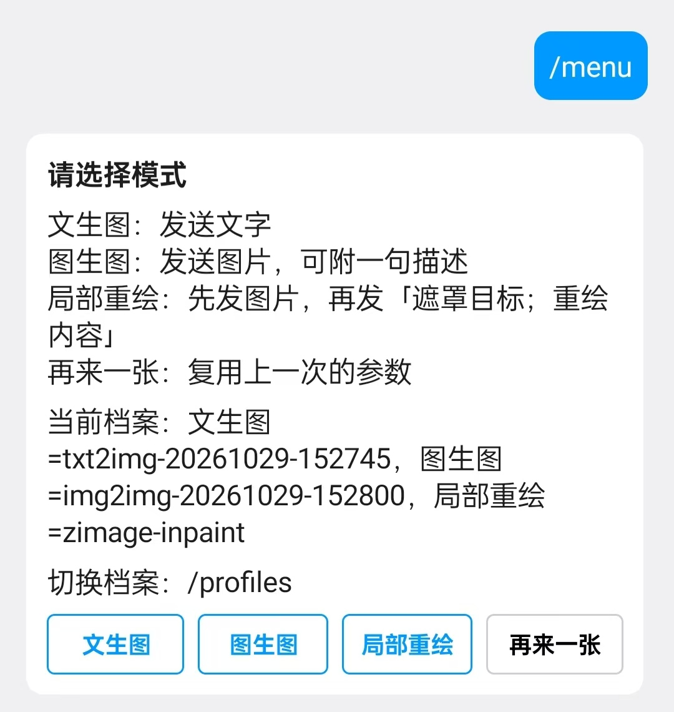
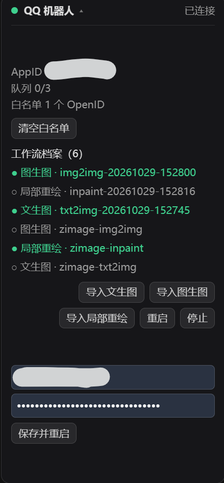

# comfyui-qq-bridge

用 QQ 单聊遥控本地 ComfyUI：在校园网这类受限网络下，把本地部署的生图模型接到手机上用。

插件本身**不带模型、不带工作流**，只做三件事：接收 QQ 消息、把内容注入指定的 API 工作流、把结果发送到手机上的 QQ。

用哪个模型、什么采样器，由你导入的工作流档案决定。



## 背景

做这个插件的起因很具体：校园网这类受限网络里，手机上直接访问本地部署的 ComfyUI 很不方便。与其把模型搬到云端，不如让 QQ 机器人当中间人——你在手机上发消息，PC 上的本地工作流出图后回传，模型和数据都留在自己机器上。

## 适用范围

- **只支持单聊（C2C）**，不支持群聊、频道，也没有多人共享的打算。
- **只给安装者自己用**。空白名单时会把第一个说话的账号绑定为安装者，之后其他人发消息一律忽略。
- 出于对滥用风险的顾虑，本项目不提供任何多用户、公开机器人、内容农场式的用法支持。

## 功能

| 模式 | 输入 | 说明 |
| --- | --- | --- |
| 文生图 | 文字 | 把文字写进正向提示词节点 |
| 图生图 | 图片（可附一句描述） | 图片上传到 ComfyUI，描述写进工作流的提示词节点 |
| 局部重绘 | 图片 + `遮罩目标；重绘内容` | 分两步发：先发图片，再发提示词组。遮罩目标交给 SAM3 之类的文字分割节点（必须用英文），重绘内容写进正向提示词，并自动附加 `smooth edges, seamless blending, highly detailed, natural lighting, high quality` |
| 再来一张 | 一个按钮 | 复用上一次的输入，换一个种子 |

进入某个模式后只对下一条消息生效，出图后自动回到菜单，避免在手机上误触。

手机 QQ 无法把图片和文字放进同一条消息，所以图生图的描述可以省略；局部重绘因此拆成「先发图、再发提示词组」两步。

## 安装

1. 把本目录放进 `ComfyUI/custom_nodes/`。
2. 重启 ComfyUI，右下角会出现「QQ 机器人」徽标。
3. 在 [QQ 开放平台](https://q.qq.com/) 创建一个机器人，拿到 AppID / AppSecret，填进徽标里的表单。
4. 用自己的 QQ 给机器人发一条消息，插件会自动把该账号绑定进白名单。

依赖只有 `aiohttp` 和 `Pillow`，ComfyUI 自带，一般不用额外安装。

徽标展开后长这样（AppID 已打码）：



## 示例环境（作者的测试配置）

仓库附带的三份示例档案就是在下面这套环境里跑通的，仅供参考，不是插件的硬性要求。

测试机：Windows 笔记本（i7-13700H + RTX 4060 Laptop 8GB 显存 + 16GB DDR5），秋叶整合包（ComfyUI-aki-v3.2），启动器里选 `CUDA GPU 0`、「标准优化（4GB 以上）」。

模型文件：

| 文件 | 放置位置 | 用途 |
| --- | --- | --- |
| `z_image_turbo_fp32-Q4_K_M.gguf` | `models/unet/` | 主模型，Z-Image Turbo 的 GGUF 量化版（约 4.6GB） |
| `qwen_3_4b.safetensors` | `models/clip/` | 文本编码器，示例里 `CLIPLoader` 的 `type` 选 `lumina2` |
| `ae.safetensors` | `models/vae/` | VAE |
| `Z-Image-Turbo-Fun-Controlnet-Union.safetensors` | `models/loras/` | 示例档案里的 LoRA（强度 0.65），可删 |
| `sam3.safetensors` | `models/sam3/` | 局部重绘的文字分割模型 |

自定义节点：

| 插件 | 用到的节点 | 什么时候需要 |
| --- | --- | --- |
| [ComfyUI-GGUF](https://github.com/city96/ComfyUI-GGUF) | `UnetLoaderGGUF` | 三份示例都要 |
| [ComfyUI-RMBG](https://github.com/1038lab/ComfyUI-RMBG) | `SAM3Segment` | 只有局部重绘示例要 |
| [ComfyUI_UltimateSDUpscale](https://github.com/ssitu/ComfyUI_UltimateSDUpscale) | `UltimateSDUpscaleNoUpscale` | 只有局部重绘示例要 |
| [ComfyUI_essentials](https://github.com/cubiq/ComfyUI_essentials) | `MaskBlur+` | 只有局部重绘示例要 |

换模型或换 LoRA 时，改示例档案里 `unet_name` / `lora_name` 这类字面量即可，不用改插件代码。

## 工作流档案

「档案」是一份 **API 格式**的 ComfyUI 工作流 + 一张「角色 → 节点输入」的映射表，保存在 `workflows/*.json`。

### 导入方式

徽标里有三个导入按钮，分别对应文生图 / 图生图 / 局部重绘。点按钮后选择 ComfyUI 用「另存为 API 格式」导出的 JSON（不是 UI 格式的 `.json`）。

导入时会先做一次节点体检，不通过就不保存：

| 模式 | 必须找到的节点 |
| --- | --- |
| 文生图 | 可写入文字的 CLIPTextEncode、SaveImage |
| 图生图 | LoadImage、SaveImage |
| 局部重绘 | LoadImage、带文字输入的 SAM3 分割节点、CLIPTextEncode（重绘描述）、SaveImage |

三种模式都还要求工作流里有 KSampler 的 seed；文件看起来属于别的模式时会提示你换按钮。

- **手工放入**：把 API 工作流按下面的格式写成 `workflows/你的档案.json`。
- **切换**：徽标里点档案名即可启用；手机上也可以发 `/profiles` 看列表、`/use 档案id` 启用。

同一个模式可以有多份档案，但必须指定当前使用哪一份（`active_profiles`）。只有一个候选时会自动选中。

仓库里的 `workflows/zimage-*.json` 是作者的示例（Z-Image Turbo 系列），依赖的模型文件与自定义节点见上一节；缺少对应节点时会在徽标里标红，按需删改或换成自己的。

不方便用徽标时，也可以复制 `qq_bot_config.example.json` 为 `qq_bot_config.json` 手动填写，再重启 ComfyUI。

### 档案格式

```json
{
  "id": "my-inpaint",
  "label": "局部重绘",
  "mode": "inpaint",
  "targets": {
    "image":          [{ "node": "125", "input": "image" }],
    "region_prompt":  [{ "node": "86",  "input": "prompt" }],
    "draw_prompt":    [{ "node": "77",  "input": "text" }],
    "seed":           [{ "node": "79",  "input": "seed" },
                       { "node": "105", "input": "seed" }]
  },
  "output": { "node": "82" },
  "timeout": 300,
  "defaults": { "width": 768, "height": 1280 },
  "workflow": { "125": { "class_type": "LoadImage", "inputs": { "image": "" } } }
}
```

字段说明：

- **角色**：`prompt` `negative` `region_prompt` `draw_prompt` `image` `mask` `seed` `width` `height` `strength` `batch`。
- **targets 的值一律是数组**：一个角色可以写多个节点，比如基础采样器和精修采样器都要同一个种子。
- **`join`**：`replace`（默认）/ `prefix` / `append`，配 `separator`。用于把用户输入拼到工作流原有文字的前面或后面。
- **`link`**：`{ "node": "77", "input": "text", "link": ["50", 0] }` 表示把该输入直接改成一条连线，而不是写字面量。
- **`output.node`**：取哪张图，一般指向 `SaveImage`。
- **`defaults`**：该档案自己的尺寸等默认值，优先级高于全局配置。

模式与必需角色：

| mode | 必需角色 |
| --- | --- |
| `txt2img` | `prompt`、`seed` |
| `img2img` | `image`、`seed` |
| `inpaint` | `image`、`region_prompt`、`draw_prompt`、`seed` |

常见坑：目标输入如果已经被连线占用（值是 `["节点", 0]` 这样的数组），写入会切断上游链路，导入时会被拦下。图生图里提示词常写成 `StringFunction.text_a` 这种上游字面量节点，再配 `join: prefix`。

## 指令

| 指令 | 作用 |
| --- | --- |
| `/menu` | 重新弹出菜单 |
| `/mode txt2img\|img2img\|inpaint` | 选择模式，等同于点按钮 |
| `/again` | 再来一张 |
| `/redraw legs；改成白色过膝袜` | 用上一次的图重绘（遮罩目标用英文） |
| `/profiles` | 列出工作流档案 |
| `/use 档案id` | 启用档案 |
| `/status` | ComfyUI 连接、队列、当前任务 |
| `/cancel` | 中断当前生成 |
| `/save 名字 提示词`、`/list`、`/get 名字`、`/del 名字` | 提示词收藏夹 |

## 平台限制

以下都是 QQ 开放平台的规则，跟本地算力无关：

- **被动回复**：同一个消息锚点最多回 4 条，窗口约 5 分钟。任务提交成功会先回一条「已收到，正在生成」，出图后回结果图 + 菜单，共 3 条。
- **主动消息**：每月 4 条。插件启动时拿不到 openid，所以不会主动推送，只在你发消息后响应。
- **消息按钮**：使用 `keyboard.content` 自定义键盘，首次发送失败会自动降级成文字菜单（回复序号），本次运行内不再重试。
- **富媒体**：图片以 base64 直传，单张控制在 3.5MB 以内，超了会自动压缩。

## 常见问题

**徽标显示「未配置」**：没填 AppID / AppSecret，或者填完没有重启子进程。

**手机点了按钮没反应**：部分账号或版本不支持自定义键盘，插件会退回文字菜单，直接回复 1-4 即可。

**生成失败，提示节点不存在**：导入的档案用到了你本机没装的自定义节点，按提示补装或改映射。

**出图后没收到图**：多半是超过了被动回复窗口（比如生成耗时超过 5 分钟）。可以把 `/status`、`gen_timeout` 调小，或换更快的工作流。

**端口冲突**：`status_port` 默认 8189，被占用时可以在 `qq_bot_config.json` 里改。

## 目录结构

```
comfyui-qq-bridge/
├─ __init__.py           宿主插件：进程管理 + HTTP 路由（配置、档案、状态）
├─ qq_comfy_bridge.py    桥接进程入口
├─ qq_bridge/            桥接实现（config / profiles / workflow / comfy / qq_api / session / menu / bot / app）
├─ web/qq_bridge.js      ComfyUI 前端徽标与设置项
├─ docs/                 README 里的截图
├─ workflows/            工作流档案（zimage-*.json 是示例，其余为你导入的档案）
├─ qq_bot_config.json    本地配置（含密钥，已被 .gitignore 忽略）
└─ prompts.json          提示词收藏夹（已被忽略）
```

## License

MIT，见 [LICENSE](LICENSE)。请勿将本项目用于违法或违反平台规则的内容生成。
